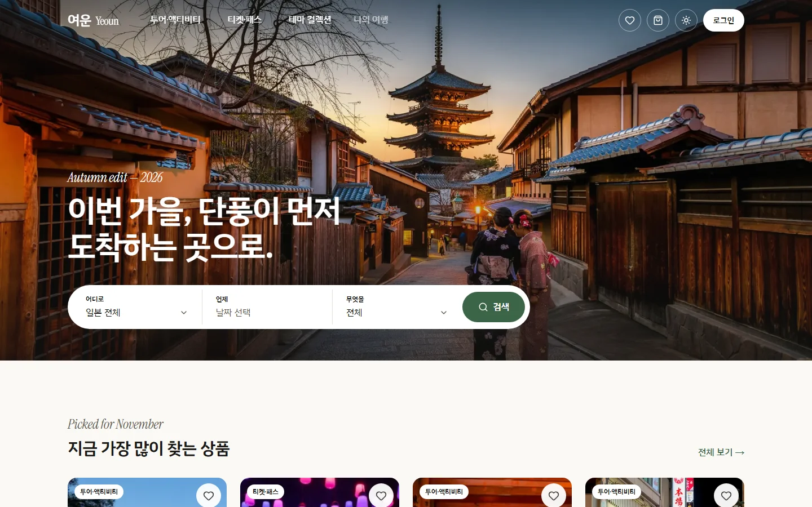
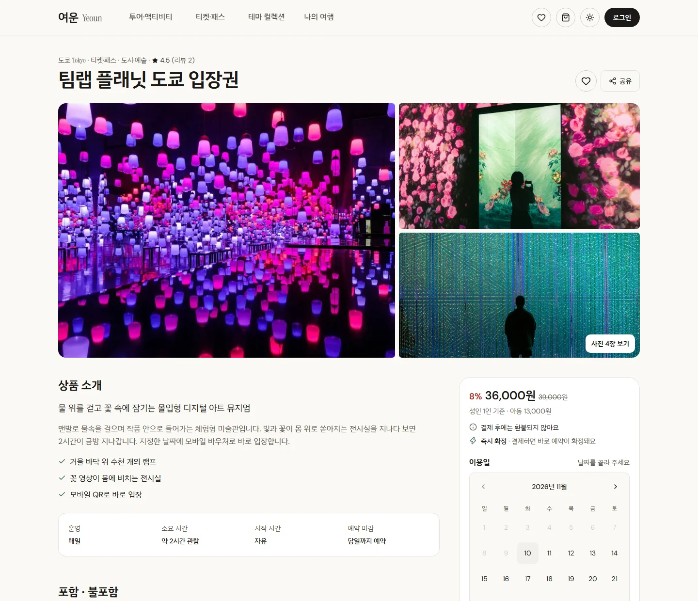
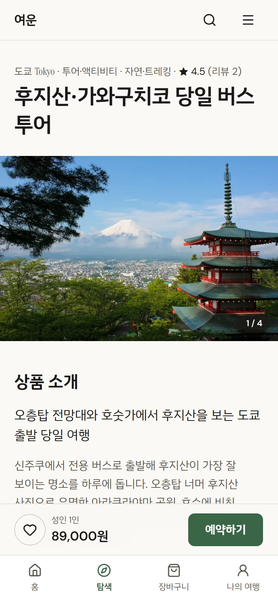
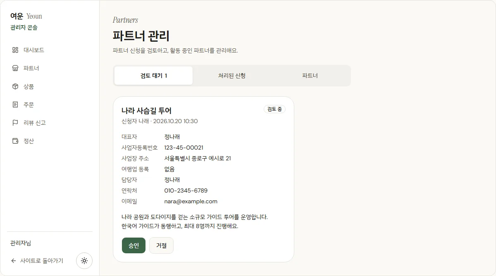

# 여운 Yeoun

> 떠나기 전의 설렘이 돌아온 뒤의 여운으로.

일본 6개 도시(도쿄·교토·오사카·후쿠오카·삿포로·오키나와)의 투어·액티비티와 입장권을 예약하는 **여행 상품 쇼핑몰**입니다. 고객 화면에 더해 **판매자(파트너) 센터와 관리자 콘솔**까지 갖춘 마켓플레이스 구조로 만들었습니다.

- **배포** — https://2026-ondo.vercel.app (개인 포트폴리오 · 결제는 모의 결제)
- **기술 스택** — Next.js 16 · TypeScript · Tailwind CSS v4 · shadcn/ui · Supabase(Postgres · Auth · Storage) · Drizzle ORM · Zod · Vercel

## 화면

<table>
  <tr>
    <td width="50%"></td>
    <td width="50%"></td>
  </tr>
  <tr>
    <td align="center">메인</td>
    <td align="center">상품 상세 · 예약 위젯</td>
  </tr>
  <tr>
    <td align="center"></td>
    <td valign="middle"></td>
  </tr>
  <tr>
    <td align="center">모바일</td>
    <td align="center">관리자 콘솔</td>
  </tr>
</table>

## 주요 기능

### 고객

- **상품 찾기** — 도시·종류·테마 필터, 검색, 정렬, 이용일로 예약 가능한 상품만 보기
- **예약 위젯** — 쉬는 날·마감·매진을 막은 달력, 회차별 남은 자리, 추가 옵션, 성인·아동 인원과 실시간 총액
- **주문** — 장바구니 → 주문서 → 모의 결제. 금액은 서버가 다시 계산하고, 동시에 결제해도 초과 판매가 없음
- **나의 여행** — 예약 내역과 상세, 모바일 바우처(QR · 이미지 저장 · 인쇄), 취소 규정에 따른 환불
- **일정 플래너** — 주문한 예약이 이용일에 자동으로 들어가고, 장소 추가 · 드래그 정렬 · 지도로 동선 확인
- **찜 · 리뷰** — 찜 폴더, 이용을 마친 구매 고객만 쓰는 리뷰(사진 1장)
- 로그인하고 돌아오면 고른 날짜·인원 그대로, 라이트/다크 모드, 360 · 768 · 1280 반응형

### 파트너 센터

- 파트너 신청 → 관리자 승인
- 상품 등록·수정(사진 · 회차 · 옵션), 날짜별 재고·가격 관리
- 예약 확정·거절 (48시간 안에 확정하지 않으면 자동 취소 · 전액 환불), 바우처 사용 처리
- 월별 정산 (수수료 15%)

### 관리자 콘솔

- 대시보드 차트와 구매 퍼널
- 파트너 승인 · 이용 정지, 상품 판매 중지
- 주문 처리 — 운영자 취소 · 환불 조정 · CS 메모 · 처리 이력
- 리뷰 신고 처리, 월 정산 확정

---

사진 [Unsplash](https://unsplash.com) · 지도 © [OpenStreetMap](https://www.openstreetmap.org/copyright) contributors · 가격·일정·리뷰는 포트폴리오용 예시 데이터입니다.
