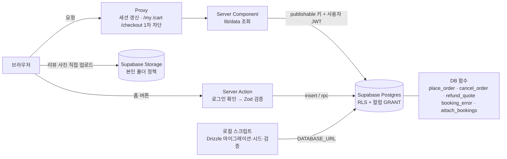

# 여운 Yeoun

> 떠나기 전의 설렘이 돌아온 뒤의 여운으로.

일본 6개 도시(도쿄·교토·오사카·후쿠오카·삿포로·오키나와)의 **투어·액티비티와 입장권을 날짜·인원을 골라 예약하는 여행 상품 쇼핑몰**입니다. 개인 포트폴리오 프로젝트로, 디자이너가 만든 디자인 시스템 명세(`design/yeoun-design-system.dc.html`)를 기준으로 구현했습니다.

**주요 기능**

- 상품 목록·상세 — 도시·상품 종류·테마 필터, 정렬, 검색(도시 이름 포함), **이용일로 예약 가능한 상품만 보기**
- 예약 위젯 — 쉬는 요일·마감·180일 이후를 막은 달력, 성인/아동 인원, 실시간 총액, 장바구니 담기·바로 구매
- 장바구니 → 주문서 → **모의 결제** → 주문 완료 (금액은 DB가 다시 계산, 중복 결제 방지)
- 나의 여행 — 예약 내역(이용 예정·완료·취소) · 예약 상세 · **취소 규정에 따른 환불액 계산과 예약 취소**
- 일정 플래너 — 주문하면 이용일에 맞춰 **예약이 자동으로 추가**(시작 시간 순), 날짜별 장소 추가·드래그 정렬·동선 지도, 찜에서 불러오기
- 리뷰 — **이용을 마친 구매 고객만** 작성(구매 인증 배지), 별점 + 텍스트 + 사진 1장
- 찜·찜 폴더, 회원가입·로그인(이메일 인증), 라이트/다크 모드, 360 / 768 / 1280 반응형

## 목차

1. [빠르게 실행하기](#1-빠르게-실행하기)
2. [기술 스택과 선택 이유](#2-기술-스택과-선택-이유)
3. [아키텍처](#3-아키텍처)
4. [폴더 구조](#4-폴더-구조)
5. [데이터베이스와 주문 보안](#5-데이터베이스와-주문-보안)
6. [디자인 시스템](#6-디자인-시스템)
7. [품질 점검](#7-품질-점검)
8. [ive 대비 개선점](#8-ive-대비-개선점)
9. [트러블슈팅](#9-트러블슈팅)
10. [배포](#10-배포)

---

## 1. 빠르게 실행하기

필요한 것: Node.js 20.9 이상(Next.js 16 요구 사항, 개발 환경은 24), Supabase 무료 프로젝트

```bash
npm install
```

```bash
cp .env.example .env.local
```

`.env.local`을 채운 뒤(각 값을 어디서 찾는지는 [.env.example](.env.example)의 주석 참고) DB를 준비합니다.

```bash
npm run db:migrate
```

```bash
npm run db:seed
```

```bash
npm run dev
```

http://localhost:3000 에서 확인합니다. 디자인 토큰과 모든 컴포넌트 상태(장바구니·예약 내역·예약 위젯 포함)는 http://localhost:3000/dev/components 에 모아 두었습니다.

> 리뷰 작성 흐름을 바로 보고 싶다면 가입한 계정 이메일을 `SEED_BUYER_EMAIL`로 주고 시드를 다시 실행하면, 그 계정에 "이용 완료" 주문 1건이 생깁니다.

### 스크립트

| 명령                            | 하는 일                                                                                        |
| ------------------------------- | ---------------------------------------------------------------------------------------------- |
| `dev` / `build` / `start`       | 개발 서버 / 프로덕션 빌드 / 프로덕션 실행                                                      |
| `typecheck` · `lint` · `format` | 타입 검사(strict) · ESLint · Prettier                                                          |
| `db:generate`                   | `src/db/schema.ts` 변경을 SQL 마이그레이션으로 생성                                            |
| `db:migrate`                    | 마이그레이션을 Supabase에 적용                                                                 |
| `db:seed`                       | 도시 6 · 상품 24 · 사진 89 · 취소 규정 3 · 데모 주문·리뷰 28 입력 (여러 번 실행해도 결과 동일) |
| `db:verify-rls`                 | 실제 DB에서 권한·주문 규칙 76개 시나리오 검증 (트랜잭션 롤백, 흔적 없음)                       |
| `db:types`                      | 실제 DB 스키마로 supabase-js 타입 생성                                                         |
| `db:studio`                     | Drizzle Studio (DB 브라우저)                                                                   |

## 2. 기술 스택과 선택 이유

| 영역                | 선택                                               | 이유                                                                                                                     |
| ------------------- | -------------------------------------------------- | ------------------------------------------------------------------------------------------------------------------------ |
| 프레임워크          | **Next.js 16** (App Router)                        | Server Component로 데이터를 서버에서 가져오고, 변경은 Server Action으로 처리해 별도 API 서버가 필요 없다                 |
| 언어                | **TypeScript** strict + `noUncheckedIndexedAccess` | 배열·객체 인덱스 접근까지 undefined 가능성을 검사. `any` 금지(ESLint)                                                    |
| 스타일              | **Tailwind CSS v4** + `@config`                    | 디자인 명세가 `tailwind.config.ts`로 제공되어 그대로 연결. 기본 팔레트를 제거해 토큰 외 색은 클래스 자체가 생성되지 않음 |
| UI                  | **shadcn/ui** (Radix)                              | 접근성(키보드·포커스·ARIA)이 검증된 프리미티브를 코드로 소유하고, 디자인 토큰으로 테마만 바꾼다                          |
| DB·인증·파일        | **Supabase** (Postgres·Auth·Storage)               | 무료 티어로 DB·인증·파일 저장을 한 곳에서. RLS와 DB 함수로 "본인 데이터만", "금액은 서버가"를 DB가 직접 보장             |
| 스키마·마이그레이션 | **Drizzle ORM**                                    | 테이블·제약·**RLS 정책까지** TypeScript로 정의하고 SQL 마이그레이션을 생성                                               |
| 입력 검증           | **Zod 4**                                          | 클라이언트(인라인 검증)와 서버(Server Action)가 같은 스키마를 공유                                                       |
| 달력                | **react-day-picker** (shadcn Calendar)             | 날짜별 비활성화(쉬는 요일·마감)를 함수 하나로 지정, 키보드 탐색 지원                                                     |
| 지도                | **Leaflet + OpenStreetMap**                        | 무료, API 키 불필요                                                                                                      |
| 드래그 정렬         | **dnd-kit**                                        | 키보드 정렬·스크린리더 안내를 지원                                                                                       |
| 배포                | **Vercel**                                         | Next.js 기본 배포 대상, 무료 티어                                                                                        |

### 설계 결정 몇 가지

- **주문 금액은 클라이언트가 정할 수 없다** — 주문·주문 항목 테이블에는 읽기 권한만 있고, 주문은 DB 함수 `place_order`로만 만든다. 클라이언트는 장바구니 id·예약자·"화면에 보인 총액"만 보내고, 함수가 상품 테이블의 현재 가격으로 다시 계산해 다르면 결제를 멈춘다.
- **예약 규칙은 DB 한 곳에** — 쉬는 요일·마감·인원·180일 규칙을 DB 함수 `booking_error` 하나로 두고 장바구니 트리거와 주문 함수가 같이 쓴다. 화면용 복사본(`src/lib/booking.ts`)은 달력을 미리 막는 UX용일 뿐이다.
- **날짜는 한국 기준 문자열** — 이용일은 `YYYY-MM-DD`, "오늘"은 DB `seoul_today()` / 앱 `seoulNow()`로 계산해 서버 시간대(UTC)와 관계없이 같다.
- **Drizzle은 스키마·마이그레이션·시드 전용, 앱의 데이터 접근은 supabase-js만** — Drizzle은 DB 관리자 권한으로 접속해 RLS를 우회한다. 사용자 요청은 항상 사용자 JWT로 실행돼야 RLS가 마지막 방어선이 된다.
- **상태의 원본은 URL** — 목록 필터(`?city=kyoto&category=tour&sort=price_asc&date=…`), 나의 여행 탭·예약 상태·폴더·선택한 여행이 모두 URL에 남아 새로고침·공유·뒤로 가기가 그대로 동작한다.
- **Cache Components 끔** — 로그인 상태를 쿠키로 읽는 구조에서는 "쿠키를 읽으면 동적 렌더링"인 기존 모델이 더 단순하고 Supabase 공식 예제와도 같다.

## 3. 아키텍처



**권한은 세 겹으로 확인합니다.**

1. **Proxy** (`src/proxy.ts`) — 매 요청 세션 토큰을 갱신하고, 로그인 없이 `/my`·`/cart`·`/checkout`에 오면 로그인으로 보낸다. 빠른 리다이렉트용.
2. **Data Access Layer** (`src/lib/auth.ts`) — 페이지·Server Action마다 `getClaims()`로 JWT 서명을 검증한다. Proxy를 우회하는 요청에 대비.
3. **DB** — RLS가 "어떤 행"을, 컬럼 단위 GRANT가 "어떤 컬럼"을, DB 함수가 "주문·취소 규칙"을 강제한다. 앱 코드에 버그가 있어도 남의 데이터를 읽거나 금액을 바꿀 수 없다.

## 4. 폴더 구조

```
src/
  app/
    (auth)/              로그인·회원가입 (6/6 분할 레이아웃, 내비 없음)
    (site)/              사이트 공통 레이아웃 (내비 + 장바구니 배지 + 푸터)
      (home)/            메인
      products/
        (list)/          목록
        [slug]/          상세 (layout.tsx에서 존재 확인 → 404)
      cart/              장바구니
      checkout/
        (form)/          주문서
        complete/[orderNo]/  주문 완료
      my/
        (tabs)/          나의 여행 (예약 내역 · 찜 · 일정 플래너)
        orders/[orderNo]/    예약 상세·취소
    auth/callback/       이메일 인증 링크가 돌아오는 Route Handler
    dev/components/      디자인 시스템 쇼케이스 (검색 노출 안 함)
  actions/               Server Actions — 모든 데이터 변경 (auth · cart · orders · likes · reviews · trips)
  components/
    ui/                  shadcn/ui 원본 (수정은 최소화하고 이유를 주석으로 남김)
    product/ cart/ checkout/ orders/ itinerary/ planner/ my/ layout/ auth/ home/   도메인 컴포넌트
  lib/
    data/                서버 전용 조회 (DB 행 → 화면용 타입으로 변환)
    supabase/            서버·브라우저·Proxy용 클라이언트
    validation/          Zod 스키마 (클라이언트·서버 공용)
    booking.ts           예약 규칙 화면용 복사본 (최종 판단은 DB)
    order-errors.ts      DB 오류 코드 → 사용자 문장
  db/                    Drizzle 스키마·마이그레이션·시드·검증 스크립트·타입 생성
  types/                 화면용 타입 + 생성된 DB 타입
docs/                    ERD(database.md) · 점검 보고서(review.md) · 배포 가이드(deploy.md)
design/                  디자인 시스템 명세 원본
```

- **화면과 데이터의 분리** — `components/`는 화면만, `actions/`·`lib/data/`는 데이터만 다룬다. "데이터는 어디서 바뀌나요?"의 답은 `actions/` 한 곳이다.
- **DB 구조와 화면 타입의 분리** — `lib/data/`가 DB 행(snake_case)을 화면용 타입(camelCase)으로 바꿔 준다.
- **라우트 그룹** — `(home)`·`(list)`·`(form)`·`(tabs)`는 URL에 나타나지 않는다. 로딩 화면이 상세·주문 완료·예약 상세의 레이아웃까지 감싸지 않게 하려고 나눴다([트러블슈팅 8](#9-트러블슈팅)).

## 5. 데이터베이스와 주문 보안

ERD·주문 흐름·함수 목록은 [docs/database.md](docs/database.md)에 있습니다.

- 테이블 15개: 카탈로그(`cities` · `products` · `product_images` · `product_itinerary_items` · `cancellation_policies` · `cancellation_policy_tiers`) / 구매(`cart_items` · `orders` · `order_items`) / 개인(`profiles` · `like_folders` · `likes` · `trips` · `trip_items`) / `reviews`
- **모든 테이블에 RLS** — 카탈로그·리뷰·프로필은 누구나 읽기만, 장바구니·찜·여행은 본인만, 주문은 본인 것 **읽기만**
- **주문** — `place_order`가 한 트랜잭션에서: 같은 중복 방지 키면 기존 주문 반환 → 장바구니 행 잠금(두 탭 동시 결제 차단) → 예약 규칙 재검사 → **가격 재계산** → 화면 금액과 다르면 `price_changed` → 주문·항목(구매 시점 상품명·단가·취소 규정 복사) 생성 → 장바구니 삭제 → 플래너에 예약 항목 추가
- **취소·환불** — 취소 확인 창의 환불 예정액과 실제 취소가 같은 함수(`refund_quote`)를 쓴다. 이용일 당일·이후, 이미 취소된 주문은 거부. 남의 주문 id에는 "없음"과 같은 오류를 돌려준다
- **리뷰** — 작성 정책에 `has_used_product`(이용일이 지난 결제 완료 주문)를 넣어 "구매 고객만"을 DB가 보장
- **플래너 예약 항목** — 사용자는 만들거나 지울 수 없고(컬럼 권한·제한 정책), 날짜·유형도 바꿀 수 없다(트리거). 여행 날짜를 바꾸면 이용일 기준으로 Day를 다시 계산
- **컬럼 단위 GRANT** — `user_id`·주문 연결 컬럼은 클라이언트가 보낼 수 없다. 장바구니에는 가격 컬럼 자체가 없다
- **검증** — `npm run db:verify-rls`가 anon / 사용자 A / 사용자 B 역할로 76개 시나리오를 실제 DB에서 실행한다. 예: 화면 금액 1,000원으로 위조 → `price_changed`, 같은 결제 재시도 → 같은 주문 1건, B가 A의 장바구니로 주문 → 거부, 이중 취소 → 거부, 환불 구간 경계일(7·6·3·2·1일 전), 구매 전 리뷰 → 거부, 예약 항목 직접 삭제 → 0행

## 6. 디자인 시스템

명세: [design/yeoun-design-system.dc.html](design/yeoun-design-system.dc.html) · 실물 확인: `/dev/components`

**컨셉** — 사진이 주인공이 되도록 UI는 한 발 물러선다. 이끼(Moss) Primary + 스톤 뉴트럴의 차분한 바탕에, 노을빛 코랄(Glow)은 찜처럼 설렘이 필요한 순간에만.

| 토큰            | 내용                                                                                   |
| --------------- | -------------------------------------------------------------------------------------- |
| 색              | 브랜드 스케일 4종(moss·lake·glow·stone, 50~900) + shadcn 시맨틱 토큰 23개(라이트/다크) |
| 글꼴            | Instrument Serif(영문 디스플레이) · DM Sans(영문·숫자) · IBM Plex Sans KR(한글)        |
| 타입 스케일     | xs 12/18 ~ 5xl 56/64 (자간 포함)                                                       |
| 간격            | Tailwind 4px 스케일 + 섹션 간격 48 / 80 / 120                                          |
| Radius · Shadow | sm 6 · md 10 · lg 16 · xl 24 / xs~lg + focus (스톤 틴트)                               |
| Motion          | 150 / 220 / 360ms, `ease-out-soft`, reduced-motion 존중                                |

- **토큰만 쓰는 규칙을 강제** — Tailwind 기본 팔레트를 `--color-*: initial`로 제거해, `bg-blue-500`을 써도 스타일이 생성되지 않는다. 하드코딩 HEX 0건.
- **명세 밖 화면** — 장바구니·주문서·완료·예약 내역·예약 위젯은 하이파이 시안이 없어 기존 토큰·컴포넌트(카드 보더, Button, Checkbox, AlertDialog, Calendar)로 구성했다. 구성 기준은 [docs/review.md 5절](docs/review.md#5-디자인-명세와-다른-부분).
- **모든 상태 구현** — 카드·필터 바·갤러리·타임라인·내비게이션·장바구니·예약 위젯의 default / hover / active / disabled / loading / empty. `/dev/components`에서 hover·focus 같은 순간 상태도 정지 화면으로 볼 수 있다(`data-preview`).

## 7. 품질 점검

S5 점검 결과 요약 ([docs/review.md](docs/review.md))

| 항목      | 결과                                                                           |
| --------- | ------------------------------------------------------------------------------ |
| 반응형    | 360 · 768 · 1280 × 9개 페이지 × 라이트/다크 가로 넘침 없음                     |
| 접근성    | axe-core WCAG 2.1 AA(색 대비 포함) 위반 0건 — 9개 페이지 × 2개 너비 × 2개 테마 |
| 권한·주문 | 실제 DB 시나리오 76/76 통과                                                    |
| 상태 코드 | 없는 상품 404 · 전환 전 주소 308 · 로그인 필요 경로 307                        |
| 성능      | 서버 응답 200~500ms(대부분 DB 왕복), 상세에 드래그 라이브러리 미포함 유지      |

**접근성에서 신경 쓴 것** — 본문 바로가기 링크, `aria-current` 내비게이션, 칩 `aria-pressed` / Segmented `radiogroup`, 결과 수·총액 `aria-live`, 인원 버튼에 "성인 한 명 더하기" 같은 이름, 장바구니 배지 숫자를 링크 이름에 포함, 라이트박스 포커스 트랩, 키보드 드래그 정렬과 한국어 스크린리더 안내, 입력 오류 `aria-invalid` + `aria-describedby`, 터치 영역 44px.

## 8. ive 대비 개선점

참고 프로젝트 ive(PHP + Smarty + jQuery)에서 가져온 코드는 `debounce` 하나뿐입니다(`src/lib/debounce.ts`, 출처 주석). 쇼핑몰의 서비스 흐름(한 나라 상품·카테고리·장바구니 → 예약자 정보 → 결제 → 예약 내역, 단계별 취소 규정)은 ive의 화면을 참고했지만, API·결제·DB 코드는 가져오지 않고 새로 설계했습니다.

| ive                                                     | 여운                                                                        |
| ------------------------------------------------------- | --------------------------------------------------------------------------- |
| ESLint·Prettier·editorconfig 없음                       | ESLint(any 금지) + Prettier(+Tailwind 클래스 정렬), `typecheck` 스크립트    |
| TypeScript는 파일 2개에만 적용                          | 전체 TypeScript strict + `noUncheckedIndexedAccess`                         |
| 14,657줄짜리 `iveLib.js`에 DOM·API·유틸 혼재, 전역 함수 | 관심사별 작은 모듈, ES module, 숨은 전역 의존 없음                          |
| 파일 이름 규칙 혼재 (camel·Pascal·snake·kebab)          | 파일 kebab-case, 컴포넌트 PascalCase로 통일                                 |
| `package.json`·lockfile이 git에서 제외됨                | lockfile 커밋으로 설치 재현 가능, 빌드 산출물은 제외                        |
| 권한·금액 확인이 애플리케이션 코드에 분산               | DB의 RLS + 컬럼 GRANT + 주문 함수가 최종 보장, 코드는 Proxy·DAL로 이중 확인 |
| 색·간격 값이 SCSS에 흩어짐                              | 디자인 토큰 단일 출처, 토큰 외 색은 생성 자체를 차단                        |
| `debounce`에 취소 수단 없음                             | 제네릭 타입 + `cancel()` (언마운트 시 대기 중 호출 취소)                    |

## 9. 트러블슈팅

개발 중 실제로 부딪힌 문제와 해결 과정입니다.

**1. Tailwind v4에서 명세의 `container` 패딩이 일부 빠짐**
v3 형식의 config를 `@config`로 불러오면 `container.screens`에 없는 md(768) 패딩 32px이 출력되지 않았다. 빌드 결과 CSS를 직접 확인해 원인을 찾고, `container`만 CSS `@utility`로 같은 값을 정의했다.

**2. 명세의 RGB 채널 변수가 shadcn 4 컴포넌트와 맞지 않음**
명세는 `--primary: 59 100 71` 형식인데 shadcn 4는 `color-mix(in oklch, var(--secondary), …)`처럼 변수를 완성된 색으로 쓴다. 변수를 HEX로 저장하고 config에서 `var(--x)`로 참조했다.

**3. `drizzle-kit migrate`가 에러 없이 멈춤**
같은 연결 문자열로 직접 접속해 보니 `password authentication failed` — 비밀번호에 `[YOUR-PASSWORD]`의 대괄호가 남아 있었다. 도구가 에러를 삼킬 때는 같은 설정으로 가장 단순한 쿼리부터 실행해 보는 것이 빨랐다.

**4. Drizzle로 앱 데이터를 읽으면 RLS가 적용되지 않음**
Drizzle은 관리자 권한으로 접속해 RLS를 우회한다. 앱 데이터 접근은 모두 supabase-js(사용자 JWT)로만 하고 Drizzle은 스키마·마이그레이션·시드 전용으로 나눴다.

**5. 리뷰를 upsert로 저장하면 권한 오류**
리뷰 대상 컬럼을 수정하지 못하게 컬럼 권한을 막아 두었는데, upsert는 충돌 시 UPDATE에 그 컬럼을 포함한다. 기존 리뷰를 조회해 insert / update로 나눴다.

**6. 사진 업로드를 Server Action으로 하면 배포 환경에서 실패할 수 있음**
Vercel 요청 크기 제한(약 4.5MB)이 허용 사진 크기(5MB)보다 작다. 브라우저에서 Storage로 직접 올리고 Server Action에는 경로만 보낸다.

**7. dnd-kit 때문에 hydration 불일치**
접근성용 요소 ID를 전역 카운터로 만들어 서버·클라이언트 값이 달랐다. `useId()`로 만든 고정 ID를 `DndContext`에 넘겼다.

**8. 없는 페이지가 HTTP 200 (soft 404)**
`loading.tsx`가 있으면 응답이 Suspense로 먼저 시작되고 그 순간 200이 확정된다. 상위 경로의 로딩 화면이 상세 레이아웃까지 감싸고 있었다. 로딩 화면을 라우트 그룹으로 옮기고 레이아웃에서 존재를 확인해 404를 만들었다. 상품 상세·주문 완료·예약 상세에 같은 방식을 쓴다.

**9. 상세 페이지가 드래그 라이브러리를 불러옴**
상세 `loading.tsx`가 스켈레톤 하나를 편집용 타임라인 파일에서 가져오고 있었다(청크 내용을 직접 검색해 찾음). 공용 부품 파일을 분리했다.

**10. shadcn `CommandDialog`가 열리지 않음 / 서버 렌더링 시 Select 값이 빈칸**
이 버전의 `CommandDialog`는 cmdk 루트를 포함하지 않아 `<Command>`로 감쌌다. Radix Select는 hydration 전에 선택 텍스트를 못 그려 `SelectValue`에 라벨을 직접 넘겼다.

**11. Leaflet이 서버에서 터지고, 지도 마커가 이름 없는 버튼**
`next/dynamic(ssr: false)`로 브라우저에서만 불러오고, z-index가 내비를 덮지 않게 `isolate`. 표시용 마커는 기본 `role=button`이라 axe가 잡아 `interactive={false} keyboard={false}`로 바꿨다.

**12. 시드 사진이 장소와 다름**
디자인 시안의 "아이슬란드 서부" 사진은 남부 폭포였다. 이후 일본 상품 사진은 115장 후보를 한 화면에 모아 직접 보고, 상품명이 아니라 "사진에 보이는 것"으로 alt를 썼다.

**13. drizzle-kit이 만든 마이그레이션이 적용되지 않음 (쇼핑몰 전환)**
`DROP TABLE … CASCADE`로 FK가 이미 지워졌는데 같은 FK를 다시 지우려 했고, 다른 파일에서는 컬럼보다 기본 키를 먼저 만들었다. 생성본 순서를 고치고 이유를 파일에 남겼다. 파괴적 마이그레이션은 **실제 DB에서 트랜잭션 안에 적용한 뒤 롤백**해 먼저 점검했다.

**14. 같은 트랜잭션에서 추가한 enum 값을 쓸 수 없음**
일정 유형에 `booking`을 추가하면서 같은 마이그레이션의 CHECK에 쓰자 Postgres가 "unsafe use of new value"로 거부했다. CHECK는 `type::text`로 비교하고, 함수는 실행 시점에 해석되는 plpgsql로 썼다.

**15. 필터 함수가 쿼리를 미리 실행할 뻔함**
supabase 쿼리 빌더는 then이 있는 객체라, async 함수에서 돌려주면 await되는 순간 실행된다. 필터 적용 함수를 동기로 만들고 비동기 조회는 밖으로 뺐다.

**16. 결제 실패 후 휴대폰 번호가 사라짐**
React 19 폼 액션은 끝나면 폼을 초기화한다. 기본값이 있는 이름·이메일은 다시 채워지고 기본값 없는 휴대폰만 비었다. 입력을 상태로 유지(controlled)했다.

**17. 모바일에서만 가로로 넘침**
이 프로젝트의 `sm`은 명세 브레이크포인트 360px인데 Tailwind 기본값(640px)으로 착각해 `sm:`을 썼고, CSS 그리드의 암묵 열이 내용 폭만큼 늘었다. 데스크톱 분기는 `md:`로, 그리드는 `grid-cols-1`(minmax(0,1fr))로 고쳤다.

**18. 4일 이상 여행에서 Day 탭이 넘쳐 클릭이 안 됨**
shadcn `TabsList`의 `group-data-horizontal/tabs:h-8`이 `h-auto`보다 우선해 줄바꿈된 탭이 틀 밖으로 넘쳤다. 같은 변형(`group-data-horizontal/tabs:h-auto`)으로 덮어썼다.

**19. 예약 항목 삭제가 아무 반응 없이 끝남**
DB 제한 정책은 오류가 아니라 "0행 삭제"로 막는다. 먼저 예약 항목인지 확인해 이유를 안내하고, 삭제 버튼 자체를 숨겼다.

## 10. 배포

[docs/deploy.md](docs/deploy.md) — Vercel 프로젝트 생성, 환경 변수(빌드 시 박히는 `NEXT_PUBLIC_` 주의, 비밀 키는 Vercel에 넣지 않음), Supabase 인증 URL, 리전, 배포 후 확인 목록.

---

사진: [Unsplash](https://unsplash.com) (무료 라이선스) · 지도: © [OpenStreetMap](https://www.openstreetmap.org/copyright) contributors · 가격·일정·리뷰는 포트폴리오용 예시 데이터이며, 결제는 실제로 이루어지지 않습니다.
