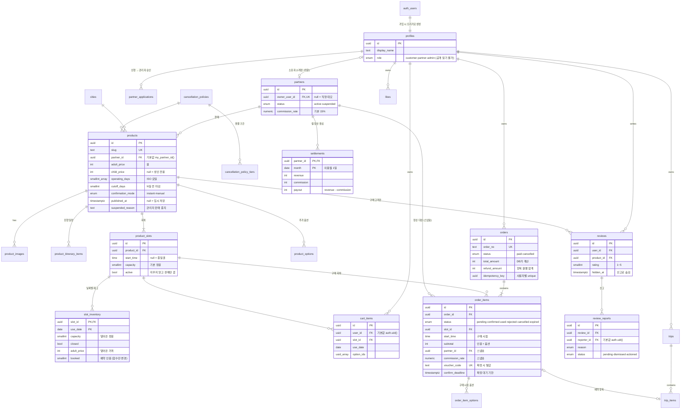
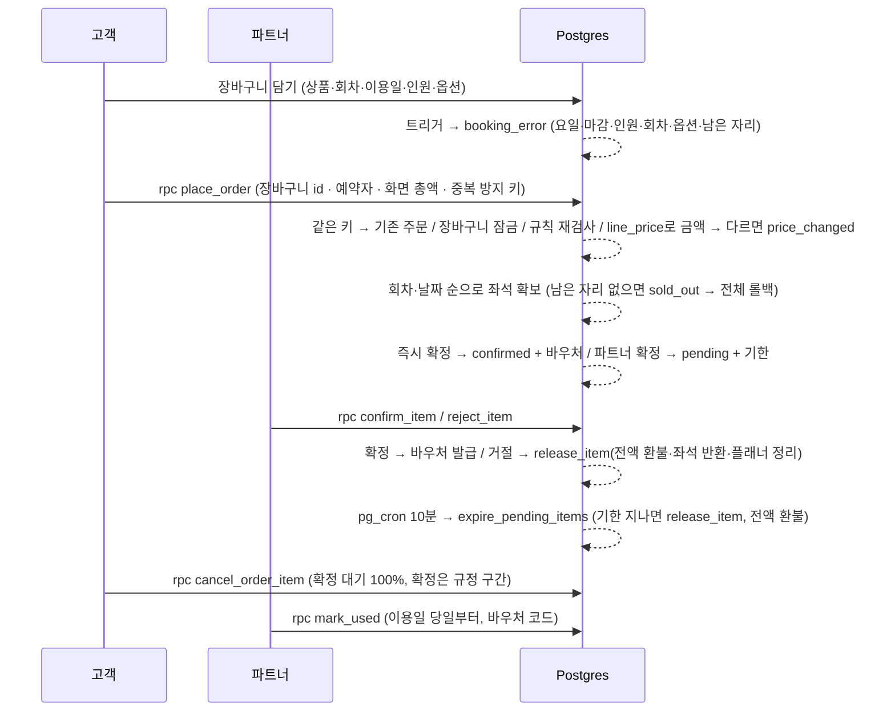

# 데이터베이스 설계 (ERD)

- 스키마 정의: [`src/db/schema.ts`](../src/db/schema.ts) (Drizzle, RLS 정책 포함)
- 마이그레이션: [`src/db/migrations`](../src/db/migrations)
  - `0000`~`0002` — 여행지 소개 사이트 시절의 기본 구조 (프로필·찜·여행·리뷰·Storage)
  - `0003`~`0007` — 쇼핑몰 전환: 여행지 삭제, 도시·상품·취소 규정·장바구니·주문, 예약 규칙·주문·취소·환불 함수, 플래너 연결
  - `0008`~`0010` — 역할·파트너: `is_admin()`·`my_partner_id()`(정책보다 먼저), 파트너·파트너 신청, 기존 상품을 "여운 직영"으로 이전, 관리자 승인 함수
  - `0011`~`0012` — 회차 재고·옵션·항목 상태: 기존 주문·장바구니 이전, 좌석 확보(`place_order` v3), 항목 단위 취소, `release_item`
  - `0013`~`0015` — 파트너 센터: 상품 사진 Storage, `save_product`, 재고 일괄 수정, 예약 확정·거절·바우처, 자동 만료 + pg_cron
  - `0016`~`0017` — 정산: `settlements` 스냅숏, 정산 계산 함수, 관리자 정산 완료
  - `0018`~`0019` — 관리자 콘솔: 리뷰 신고·숨김, 상품 판매 중지, 대시보드 통계
- 시드: [`src/db/seed.ts`](../src/db/seed.ts), [`src/db/seed-data.ts`](../src/db/seed-data.ts)
- 검증: [`src/db/verify-rls.ts`](../src/db/verify-rls.ts) (역할별 204개 시나리오, 롤백) · [`src/db/verify-race.ts`](../src/db/verify-race.ts) (동시 결제)

## ERD

`cities`·`product_images`·`product_itinerary_items`·`product_options`·`order_item_options`·`partner_applications`·`like_folders`·`likes`·`trips`·`trip_items`는 그림을 간단히 하려고 컬럼을 생략했다 (스키마 파일 참고).

## 예약 흐름과 DB 함수

| 함수                                                               | 실행 권한                 | 하는 일                                                                              |
| ------------------------------------------------------------------ | ------------------------- | ------------------------------------------------------------------------------------ |
| `is_admin()` · `my_partner_id()` · `my_profile()`                  | definer                   | 역할 판단 (정책·함수에서 사용), 본인 계정 정보                                       |
| `booking_error(상품, 날짜, 회차, 성인, 아동, 옵션)`                | invoker                   | 예약할 수 없으면 이유 코드(`cutoff`·`slot_closed`·`sold_out`…), 가능하면 null        |
| `line_price(…)`                                                    | invoker                   | 날짜별 덮어쓴 가격 + 옵션 금액 — 장바구니 화면과 결제가 같은 공식                    |
| `place_order(…)`                                                   | definer                   | 금액 재계산·중복 결제 방지·장바구니 잠금·**좌석 확보**·플래너 연결을 한 트랜잭션으로 |
| `release_item(항목, 상태, 환불액)`                                 | 내부 전용                 | 취소·거절·만료 공통: 좌석 반환·예약 일정 삭제·주문 환불 합계·전체 취소 판정          |
| `cancel_order_item` · `cancel_order` · `refund_quote`              | definer / definer / inv.  | 항목·주문 취소, 환불 예정액(확인 창과 실제 취소가 같은 계산)                         |
| `approve_/reject_partner_application` · `admin_set_partner_status` | definer + `is_admin()`    | 파트너 신청 처리, 이용 정지                                                          |
| `save_product(…)`                                                  | invoker (RLS·GRANT 적용)  | 상품·사진·진행 일정·회차·옵션을 한 트랜잭션으로 저장                                 |
| `set_inventory_range(…)`                                           | invoker                   | 기간 × 요일 정원·마감·가격 덮어쓰기 (예약보다 적은 정원은 트리거가 거부)             |
| `partner_bookings` · `confirm_item` · `reject_item` · `mark_used`  | definer + `my_partner_id` | 파트너 예약 목록(연락처 포함), 확정·거절, 바우처 사용 처리                           |
| `expire_pending_items()`                                           | definer                   | 기한 지난 확정 대기 자동 취소 (pg_cron 10분 + 화면을 열 때)                          |
| `settlement_items` · `settlement_summary`                          | definer + 범위 확인       | 정산 대상 항목·월 합계 (파트너는 자기 것만, 관리자는 전체)                           |
| `admin_settle_month`                                               | definer + `is_admin()`    | 끝난 달 정산 완료 → `settlements`에 숫자 고정                                        |
| `resolve_review_report` · `admin_set_review_hidden`                | definer + `is_admin()`    | 신고 기각·숨김, 숨김 해제                                                            |
| `admin_set_product_suspension`                                     | definer + `is_admin()`    | 상품 판매 중지·재개                                                                  |
| `admin_kpis` · `admin_daily_stats` · `admin_breakdown`             | definer + `is_admin()`    | 대시보드 지표·일별 결제·도시/종류별 매출                                             |
| `has_used_product` · `attach_bookings` · `reorder_trip_items`      | invoker / definer / inv.  | 리뷰 자격(항목 상태 기준), 플래너 예약 붙이기, 일정 순서 저장                        |

security definer 함수는 모두 `search_path = ''`와 스키마를 붙인 이름만 쓴다. 고객 함수는 `auth.uid()`, 파트너 함수는 `my_partner_id()`, 관리자 함수는 `is_admin()`으로 첫 줄에서 확인하고, 남의 데이터 id에는 "없음(`not_found`)"과 같은 오류를 돌려줘 존재 여부를 알 수 없게 한다.

## 설계 결정

| 결정                                                                      | 이유                                                                                                                                            |
| ------------------------------------------------------------------------- | ----------------------------------------------------------------------------------------------------------------------------------------------- |
| 주문·주문 항목은 **읽기 권한만**, 생성·취소·확정은 DB 함수로만            | 클라이언트가 금액·상태를 넣을 수 있으면 위조할 수 있다. 가격은 `line_price`로 다시 계산하고 화면 금액은 "확인용"으로만 받는다                   |
| 역할 판단은 RLS + definer 함수                                            | 로그인 사용자는 모두 DB 역할 `authenticated` — 컬럼 GRANT로는 파트너·관리자를 나눌 수 없다. 관리자 전용 컬럼은 GRANT 없이 함수로만 바꾼다       |
| 좌석은 "조건부 UPDATE 한 문장"으로 확보                                   | `booked + 인원 <= 정원`일 때만 늘린다. 동시 결제는 행 잠금 뒤 바뀐 값으로 다시 평가돼 초과 판매가 없다. 잠금 순서(회차·날짜)를 고정해 교착 방지 |
| 불변식: `booked` = 살아 있는 항목 인원 합                                 | 늘리는 곳은 `place_order`, 줄이는 곳은 `release_item` 하나. 기존 데이터 이전·시드도 같은 규칙으로 맞췄다                                        |
| 회차·옵션은 지우지 않고 판매만 끈다                                       | 장바구니·주문 항목이 참조한다. 시드·`save_product` 모두 upsert + `active = false`                                                               |
| 주문 항목에 **구매 시점** 상품명·단가·회차 시간·옵션·파트너·수수료율 복사 | 나중에 상품·수수료율이 바뀌어도 예약 내역과 정산은 산 그대로여야 한다                                                                           |
| 파트너에게 `orders` 읽기 정책 없음                                        | 한 주문에 다른 파트너 상품이 섞이면 총액·중복 방지 키 등이 보인다. 예약자 연락처는 `partner_bookings`로 필요한 열만                             |
| 자동 만료 = pg_cron + 화면을 열 때                                        | 무료 프로젝트가 일시 정지되면 cron이 멈춘다. 멱등 함수라 화면을 열 때 한 번 더 불러도 안전하다                                                  |
| 정산 완료 = 스냅숏                                                        | 관리자가 처리한 뒤 데이터가 바뀌어도 그 달 숫자는 그대로. 처리 전 달은 실시간 계산                                                              |
| 숨긴 리뷰: 제한 정책을 anon·로그인으로 나눔                               | anon에게는 `is_admin()` 실행 권한이 없다. 정책 대상 역할을 나눠 anon 정책에서는 함수를 부르지 않는다                                            |
| 예약 규칙은 DB 함수 하나(`booking_error`)                                 | 장바구니 트리거와 주문 함수가 같은 규칙. 화면용 복사본(`src/lib/booking.ts`)은 달력 비활성화 등 UX용이고 최종 판단은 항상 DB                    |
| 날짜는 `seoul_today()` 기준                                               | DB 서버 시간대(UTC)와 관계없이 한국(=일본) 날짜로 마감·환불·정산 월을 계산한다                                                                  |
| 앱의 데이터 접근은 supabase-js, Drizzle은 스키마·마이그레이션·시드 전용   | Drizzle은 postgres 권한으로 접속해 RLS를 우회한다. 사용자 요청은 항상 사용자 JWT로 실행돼야 RLS가 마지막 방어선이 된다                          |

## 권한 요약 (역할 × 테이블)

| 대상                                                       | anon             | 고객                                     | 파트너                             | 관리자                                      |
| ---------------------------------------------------------- | ---------------- | ---------------------------------------- | ---------------------------------- | ------------------------------------------- |
| 공개 상품 · 사진 · 일정 · 회차 · 옵션 · 재고 · 도시 · 규정 | 읽기             | 읽기                                     | 읽기 + 본인 상품 쓰기(내용 컬럼만) | 전체 읽기(임시 저장 포함), 판매 중지는 함수 |
| profiles                                                   | 표시 정보만      | 표시 정보 읽기, 본인 수정 (역할 불가)    | 같음                               | 같음 (역할 변경은 승인 함수)                |
| cart_items                                                 | —                | 본인 것만 (가격 컬럼 없음)               | 같음                               | 같음                                        |
| orders                                                     | —                | 본인 것 읽기만                           | — (연락처는 `partner_bookings`)    | 전체 읽기                                   |
| order_items · order_item_options                           | —                | 본인 것 읽기만                           | 본인 상품 항목 읽기, 처리는 함수   | 전체 읽기                                   |
| partner_applications                                       | —                | 본인 신청·읽기                           | 본인                               | 전체 + 승인·거절 함수                       |
| partners · settlements                                     | —                | —                                        | 본인                               | 전체 + 상태·정산 함수                       |
| reviews                                                    | 읽기 (숨김 제외) | 읽기, 이용 완료 상품에 작성, 본인 수정   | 같음                               | 숨긴 리뷰 포함 읽기 + 숨김 함수             |
| review_reports                                             | —                | 본인 신고·읽기 (본인 리뷰·중복 불가)     | 같음                               | 전체 + 처리 함수                            |
| likes · like_folders · trips · trip_items                  | —                | 본인 것만 (예약 항목은 만들기·삭제 불가) | 같음                               | 같음                                        |
| storage `review-photos` / `product-images`                 | 공개 URL로 보기  | 본인 폴더에만 리뷰 사진                  | 파트너 폴더에만 상품 사진          | —                                           |

쓰기 정책이나 GRANT가 없는 동작은 모두 거부된다. 예약 인원 카운터(`slot_inventory.booked`)·주문 상태·정산 기록은 누구도 직접 쓸 수 없고 함수만 바꾼다.
