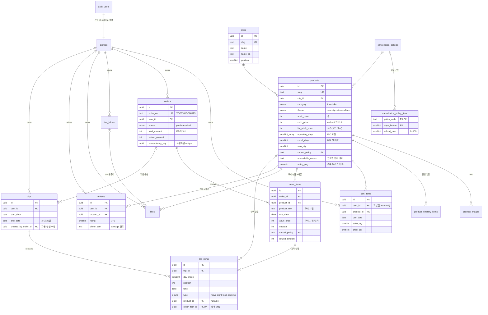
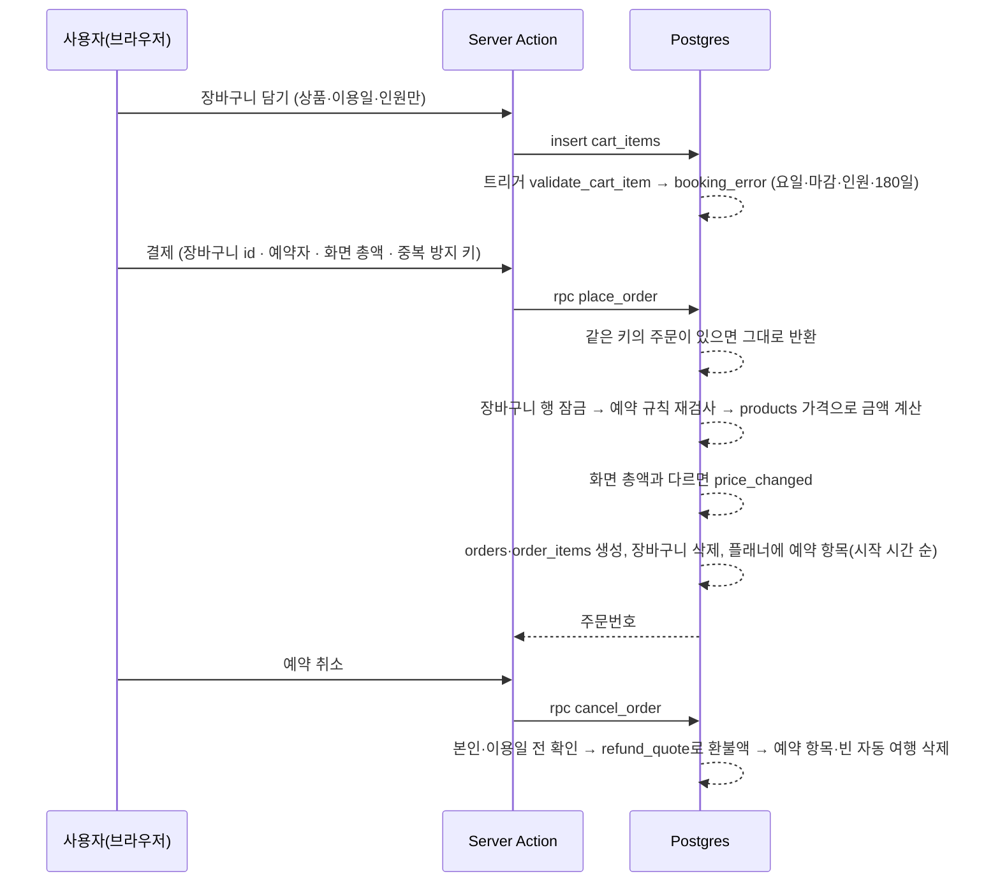

# 데이터베이스 설계 (ERD)

- 스키마 정의: [`src/db/schema.ts`](../src/db/schema.ts) (Drizzle, RLS 정책 포함)
- 마이그레이션: [`src/db/migrations`](../src/db/migrations)
  - `0000_init` · `0001_triggers_grants_storage` · `0002_reorder_trip_items` — 여행지 소개 사이트 시절의 기본 구조 (프로필·찜·여행·리뷰·Storage)
  - `0003_drop_destinations` — 쇼핑몰 전환 1/3: 여행지 테이블 삭제 (drizzle-kit 생성본의 순서 오류를 고친 기록 포함)
  - `0004_shop_schema` — 쇼핑몰 전환 2/3: 도시·상품·취소 규정·장바구니·주문 테이블
  - `0005_shop_functions_grants` — 쇼핑몰 전환 3/3: 예약 규칙·주문·취소·환불 함수, 트리거, 컬럼 권한
  - `0006_trip_created_by_order` — 주문 취소 시 비어 버린 자동 생성 여행 삭제
  - `0007_attach_bookings_time_order` — 예약 항목을 시작 시간 순으로, 새 여행에 기존 예약 붙이기
- 시드: [`src/db/seed.ts`](../src/db/seed.ts), [`src/db/seed-data.ts`](../src/db/seed-data.ts)
- 권한·주문 검증: [`src/db/verify-rls.ts`](../src/db/verify-rls.ts) (76개 시나리오)

## ERD

`profiles`·`like_folders`·`likes`·`product_images`·`product_itinerary_items`는 그림을 간단히 하려고 컬럼을 생략했다 (스키마 파일 참고).

## 주문 흐름과 DB 함수

| 함수                                           | 실행 권한             | 하는 일                                                                                |
| ---------------------------------------------- | --------------------- | -------------------------------------------------------------------------------------- |
| `booking_error(상품, 이용일, 성인, 아동)`      | 호출자 (invoker)      | 예약할 수 없으면 이유 코드(`cutoff`·`closed_day`·`qty`…), 가능하면 null                |
| `place_order(장바구니 id들, 예약자, 총액, 키)` | 함수 소유자 (definer) | 주문 생성 — 금액 재계산·중복 결제 방지·장바구니 잠금·플래너 연결을 한 트랜잭션으로     |
| `refund_quote(주문)`                           | 호출자                | 항목별 남은 일수·환불률·환불액. 취소 확인 창과 실제 취소가 같은 계산을 쓴다            |
| `cancel_order(주문)`                           | 함수 소유자           | 본인 주문·이용일 전만 취소, 환불액 기록, 예약 항목과 비어 버린 자동 생성 여행 삭제     |
| `has_used_product(상품)`                       | 호출자                | 이용일이 지난 결제 완료 주문이 있는지 → 리뷰 작성 정책(`reviews_insert_own`)에 쓰인다  |
| `attach_bookings(여행)`                        | 함수 소유자           | 여행 기간 안의 "플래너에 없는 예약"을 붙인다 (여행 생성·기간 변경 후 호출)             |
| `add_booking_to_trip(여행, 주문 항목)`         | 내부 전용 (권한 없음) | 예약 항목 1개를 시작 시간 순 자리에 삽입 — `place_order`·`attach_bookings`가 같이 쓴다 |
| `reorder_trip_items(여행, Day, id 순서)`       | 호출자                | 같은 날 항목 순서를 한 번에 저장                                                       |

함수 소유자 권한(security definer) 함수는 모두 `search_path = ''`와 스키마를 붙인 이름만 쓰고, 첫 줄에서 `auth.uid()`로 본인 확인을 한다. 남의 주문·여행 id에는 "없음(`not_found`)"과 같은 오류를 돌려줘 존재 여부를 알 수 없게 한다.

## 설계 결정

| 결정                                                                    | 이유                                                                                                                                      |
| ----------------------------------------------------------------------- | ----------------------------------------------------------------------------------------------------------------------------------------- |
| 주문·주문 항목은 **읽기 권한만**, 생성·취소는 DB 함수로만               | 클라이언트가 금액을 넣을 수 있으면 위조할 수 있다. 가격은 `place_order`가 `products`에서 다시 계산하고, 화면 금액은 "확인용"으로만 받는다 |
| 장바구니에 **가격을 저장하지 않음**                                     | 담은 뒤 가격이 바뀌어도 항상 현재 가격을 보여주고, 결제 직전 화면 금액과 DB 계산이 다르면 결제를 멈춘다(`price_changed`)                  |
| 주문 항목에 **구매 시점 상품명·단가·취소 규정 복사**                    | 나중에 상품 정보가 바뀌어도 예약 내역은 산 그대로 보여야 한다                                                                             |
| 중복 결제 방지 키 + 장바구니 행 잠금(`for update`)                      | 결제 버튼을 두 번 누르거나 두 탭에서 동시에 결제해도 주문은 하나만 생긴다                                                                 |
| 예약 규칙을 DB 함수 하나(`booking_error`)로                             | 장바구니 트리거와 주문 함수가 같은 규칙을 쓴다. 화면용 복사본(`src/lib/booking.ts`)은 달력 비활성화 등 UX용이고 최종 판단은 항상 DB       |
| 날짜는 `seoul_today()` 기준                                             | DB 서버 시간대(UTC)와 관계없이 한국(=일본) 날짜로 마감·환불 일수를 계산한다                                                               |
| 리뷰 작성 정책에 `has_used_product`                                     | "구매 고객만 리뷰"를 앱 코드가 아니라 DB가 보장한다. 시드 리뷰도 모두 이용 완료 주문을 먼저 만든 뒤 넣었다                                |
| 예약 항목: `type = booking ⇔ order_item_id 있음` CHECK + 컬럼 권한 없음 | 사용자는 예약 항목을 만들 수 없고, 제한(restrictive) 정책으로 직접 지울 수도 없다. 날짜·유형 변경은 트리거(`guard_booking_item`)가 막는다 |
| 여행 날짜를 바꾸면 예약 항목 Day 재계산                                 | 예약 항목의 날짜는 이용일에서 정해진다. 기간이 이용일을 벗어나면 거부(`booking_out_of_range`)                                             |
| 표시 상태(이용 예정·완료)는 저장하지 않음                               | 시간이 지나면 저절로 바뀌는 값이라 저장하면 어긋난다. `paid`·`cancelled`만 저장하고 나머지는 이용일과 오늘로 계산한다                     |
| 앱의 데이터 접근은 supabase-js, Drizzle은 스키마·마이그레이션·시드 전용 | Drizzle은 postgres 권한으로 접속해 RLS를 우회한다. 사용자 요청은 항상 사용자 JWT로 실행돼야 RLS가 마지막 방어선이 된다                    |
| `user_id` 기본값 `auth.uid()` + 컬럼 GRANT                              | 클라이언트가 user_id를 보내지 않고, 보낼 수도 없다                                                                                        |
| 평점 캐시(`rating_avg`, `review_count`)                                 | 목록 정렬·표시 때마다 집계하지 않도록 리뷰 트리거가 갱신한다                                                                              |

## 권한 요약 (RLS + GRANT)

| 테이블                                                                   | anon            | authenticated                                                               |
| ------------------------------------------------------------------------ | --------------- | --------------------------------------------------------------------------- |
| cities, products, product_images, product_itinerary_items, 취소 규정 2종 | 읽기            | 읽기                                                                        |
| profiles                                                                 | 읽기            | 읽기, 본인 표시 정보 수정                                                   |
| reviews                                                                  | 읽기            | 읽기, 이용을 마친 상품에만 작성, 본인 것 수정(별점·내용·사진)·삭제          |
| cart_items                                                               | —               | 본인 것만. 상품·이용일·인원만 쓸 수 있음 (가격 컬럼 없음, 예약 규칙 트리거) |
| orders, order_items                                                      | —               | 본인 것 **읽기만** (생성·취소는 `place_order`·`cancel_order`)               |
| like_folders, likes                                                      | —               | 본인 것만 읽기·쓰기 (남의 폴더에 찜 넣기 차단)                              |
| trips, trip_items                                                        | —               | 본인 여행과 그 항목만. 예약 항목은 만들기·삭제 불가, 날짜·유형 변경 불가    |
| storage `review-photos`                                                  | 공개 URL로 보기 | 본인 폴더(`{user_id}/…`)에만 업로드·삭제, 5MB·이미지만                      |

쓰기 정책이 없는 테이블(상품 등)은 RLS에 의해 모든 쓰기가 거부된다.
