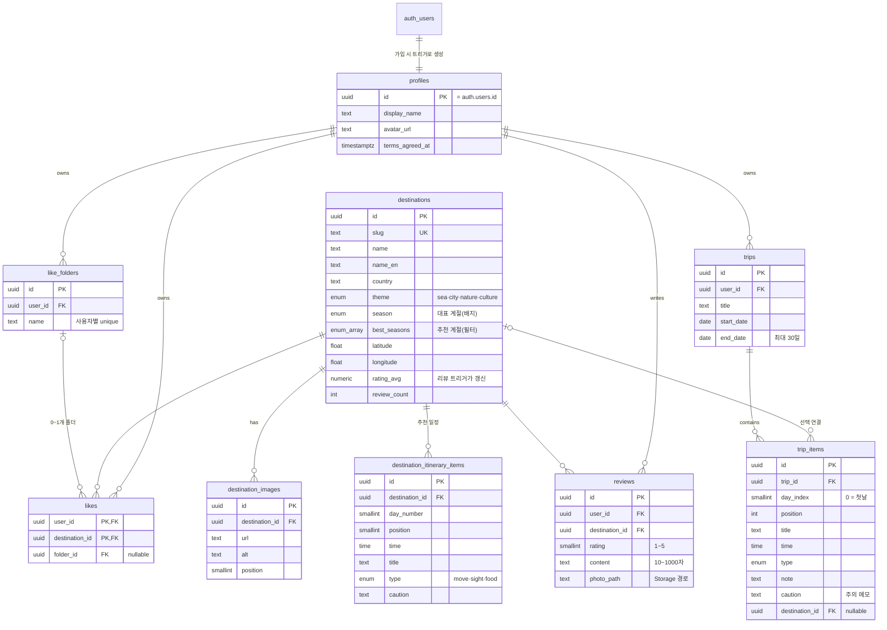

# 데이터베이스 설계 (ERD)

- 스키마 정의: [`src/db/schema.ts`](../src/db/schema.ts) (Drizzle, RLS 정책 포함)
- 마이그레이션: [`src/db/migrations`](../src/db/migrations)
  - `0000_init.sql`: 테이블·enum·FK·인덱스·RLS 정책 (자동 생성)
  - `0001_triggers_grants_storage.sql`: 트리거·권한·Storage (직접 작성)
- 시드: [`src/db/seed.ts`](../src/db/seed.ts), [`src/db/seed-data.ts`](../src/db/seed-data.ts)

## ERD

## 설계 결정

| 결정                                                                    | 이유                                                                                                                                      |
| ----------------------------------------------------------------------- | ----------------------------------------------------------------------------------------------------------------------------------------- |
| 앱의 데이터 접근은 supabase-js, Drizzle은 스키마·마이그레이션·시드 전용 | Drizzle은 postgres 권한으로 접속해 RLS를 우회한다. 사용자 요청은 항상 사용자 JWT로 실행돼야 RLS가 "마지막 방어선"이 된다                  |
| 개인 데이터는 `profiles`를 참조                                         | supabase-js에서 `reviews → profiles(display_name)` 조인이 FK로 자동 인식된다. 탈퇴 시 auth.users → profiles → 개인 데이터가 연쇄 삭제된다 |
| `user_id` 기본값 `auth.uid()`                                           | 클라이언트가 user_id를 보내지 않는다. 컬럼 단위 GRANT로 user_id 입력 자체를 막아 위조를 차단한다                                          |
| 평점 캐시(`rating_avg`, `review_count`)                                 | 목록 정렬·표시 때마다 집계하지 않도록 리뷰 트리거가 갱신한다                                                                              |
| 대표 계절 + 추천 계절 배열                                              | 카드 배지는 하나, 필터는 여러 계절에 걸리게 한다 (`season = any(best_seasons)` 체크)                                                      |
| `trip_items`는 여행지 연결 선택                                         | 찜·상세에서 담으면 여행지 연결(지도 표시), "+ 장소 추가"는 자유 장소                                                                      |
| 일정 상태(done/current)는 저장하지 않음                                 | 여행 날짜와 현재 시각으로 계산되는 값이라 저장하면 어긋날 수 있다                                                                         |

## 권한 요약 (RLS + GRANT)

| 테이블                                                        | anon            | authenticated                                          |
| ------------------------------------------------------------- | --------------- | ------------------------------------------------------ |
| destinations, destination_images, destination_itinerary_items | 읽기            | 읽기                                                   |
| profiles                                                      | 읽기            | 읽기, 본인 표시 정보 수정                              |
| reviews                                                       | 읽기            | 읽기, 본인 작성·수정(별점·내용·사진)·삭제              |
| like_folders, likes                                           | —               | 본인 것만 읽기·쓰기 (남의 폴더에 찜 넣기 차단)         |
| trips, trip_items                                             | —               | 본인 여행과 그 항목만 읽기·쓰기                        |
| storage `review-photos`                                       | 공개 URL로 보기 | 본인 폴더(`{user_id}/…`)에만 업로드·삭제, 5MB·이미지만 |

쓰기 정책이 없는 테이블(여행지 등)은 RLS에 의해 모든 쓰기가 거부된다.
